# UI/UX audit (report only)

A walk through every screen a player meets, on the built web game (version 0.331.0 · c6f2a5d), in Chromium at upright phone sizes 393x852, 360x780 and 412x915 (device pixel ratio 3, touch on). No game code was changed. Screenshots are in `docs/samples/ux-audit/` (393x852 unless the name says otherwise).

The same report as a page for the phone: https://claude.ai/artifact/GJ4kR13MVJ5dRgW2QA976h

## How it was walked

- A new save: the opening film watched through and skipped, the starter pick, the second film, the first home screen and its tip.
- A mid-game save (22 heroes at level 17, five armies cleared, Castle, Last Stand and Calamity open, sample gear, ores, shards, three chests): every tab, the top bar, the hero roster and sheet (all four tabs), talents, equipment, the Upgrades list (awakening), summoning (one and ten), the Pact Gallery, the Summoner's chain film, quests (all tabs), the codex, achievements, Hester's Stall, the daily challenge, the Last Stand picker, the Calamity, chests (one and Open all), and every Settings page.
- An army run: army picker, War Council, deploy, hire, auto place, fights at x1 and x3 through seven waves with road events, wave results and a boss film; a forced defeat; a fight with the War Horn full (`?eidolons=all`) and an Eidolon call.
- The key pages again at 360x780 and 412x915, with a check for anything off screen or clipped, and every visible control's size measured.

Not reached: a whole run's final recap screen (the forced defeat only cost a heart), an ultimate's full-screen moment and a rank-up card from the hero sheet (both covered by earlier notes' shots).

## Top ten

1. **The first session is two films and a menu before any play** (High impact, small to medium effort)
2. **Settings has a Developer page that hands out free crowns, shards and stones** (High impact, small effort)
3. **The fight HUD is cramped, and the skill banner covers the hero who casts** (High impact, medium effort)
4. **Red badges everywhere, so none of them mean anything** (High impact, medium effort)
5. **Toasts, quips and cards land on top of each other and the top bar** (High impact, medium effort)
6. **Many tap targets are under 44 px** (High impact, small effort)
7. **Films use under half the screen and their words are small** (Medium impact, medium effort)
8. **Five heroes picked, then an empty board that says "hire two"** (Medium impact, small effort)
9. **Losing a wave is barely shown** (Medium impact, small effort)
10. **Too much 8 to 10 px text** (Medium impact, medium effort)

## All findings, ranked by impact then effort

### 1. The first session is two films and a menu before any play

*First launch · impact high · effort small to medium*

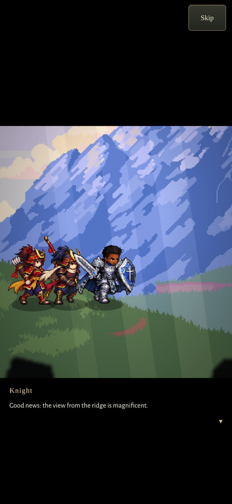 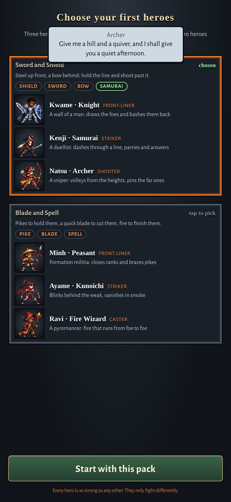 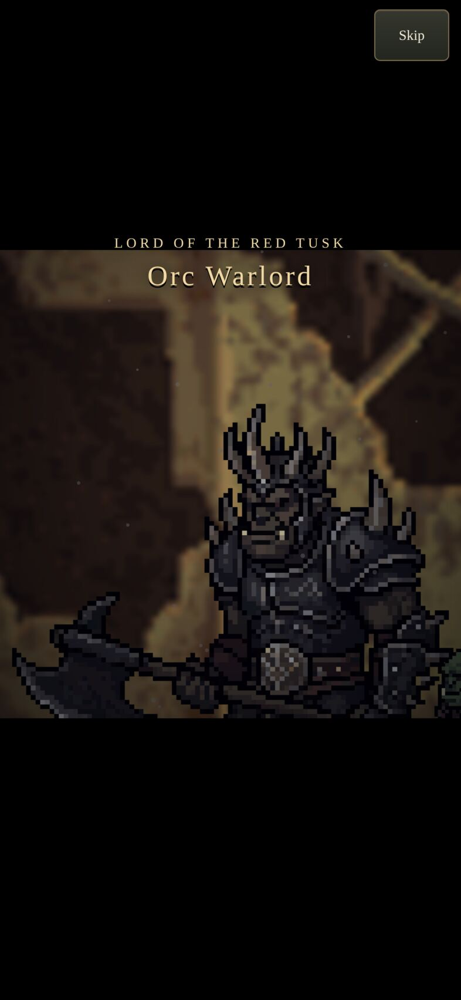 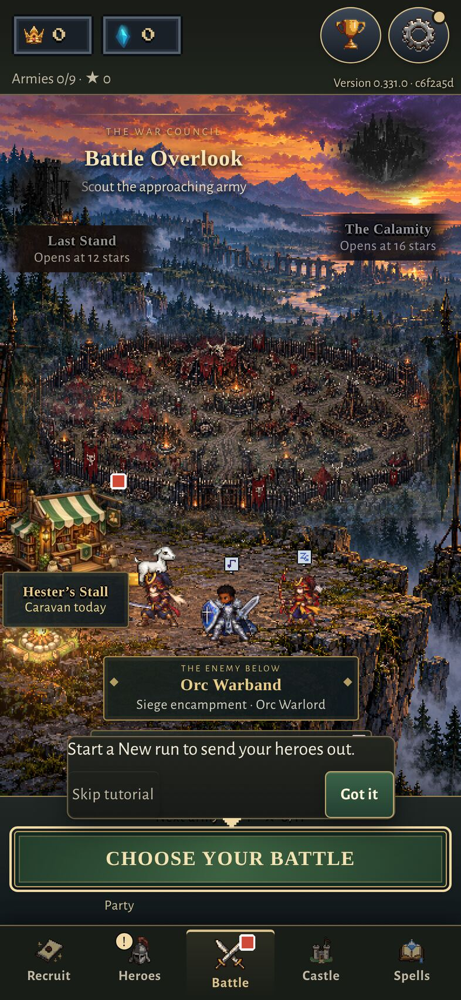

**What is wrong.** A new player sits through the ~66 s opening, picks a pack, then a second film plays (it starts on the opening's own title card and narration, then the Orc Warband's intro), and they land on the home screen with no fight started. The first tip says "Start a New run to send your heroes out", but no button says New run: the button reads "Choose your battle", and that leads to an army picker, then the War Council, then an empty deploy board.

**Recommendation.** Send a new save straight from the pack pick into wave 1 of the Orc Warband (deploy screen, with the deploy tip). Play the Warband intro either before that first deploy or not at all, never as a second title sequence. Change the tip to name the real button ("Tap Choose your battle"). Keep Skip on both films.

### 2. Settings has a Developer page that hands out free crowns, shards and stones

*Settings · impact high · effort small*

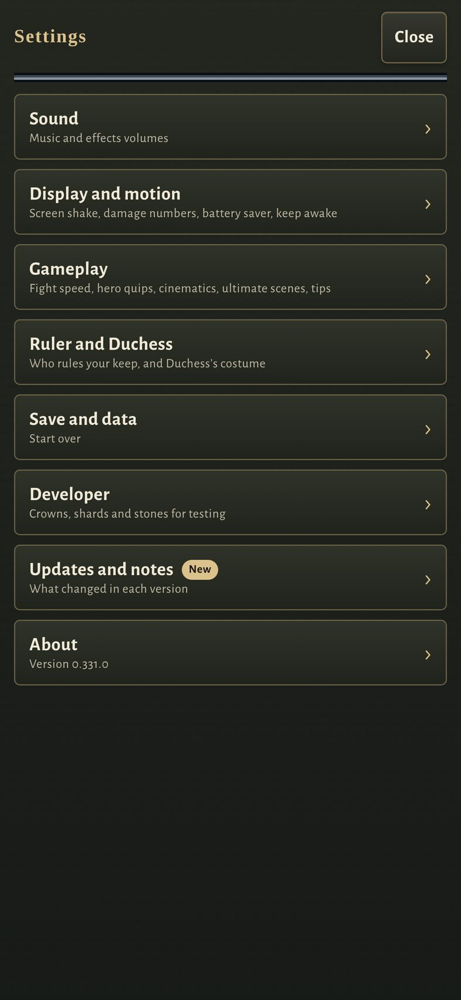 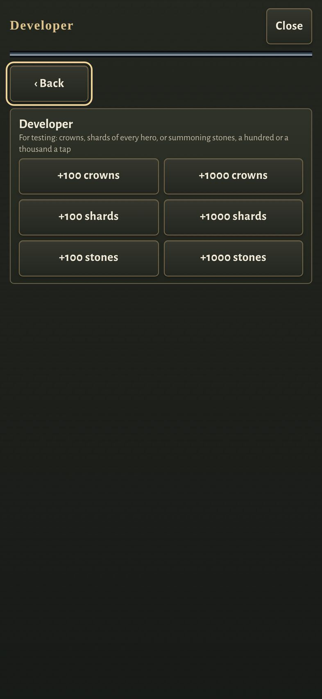

**What is wrong.** Settings › Developer has "+1000 crowns", "+1000 shards" and "+1000 stones" buttons, one tap each, visible to every player. It undercuts every economy screen in the game (the stall, chests, the summoning hall, rank-ups).

**Recommendation.** Show the Developer row only behind a URL flag (the game already has ?eidolons=all) or a hidden gesture, and leave it out of release builds.

### 3. The fight HUD is cramped, and the skill banner covers the hero who casts

*Fight · impact high · effort medium*

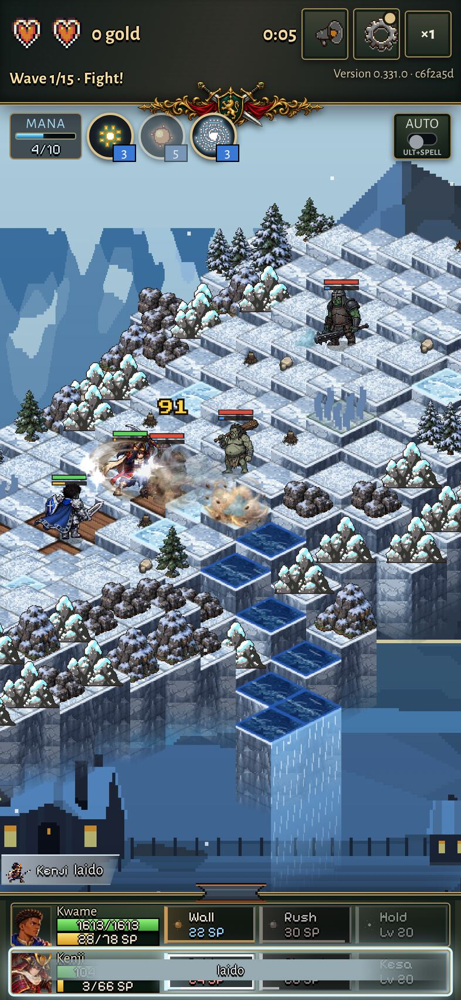 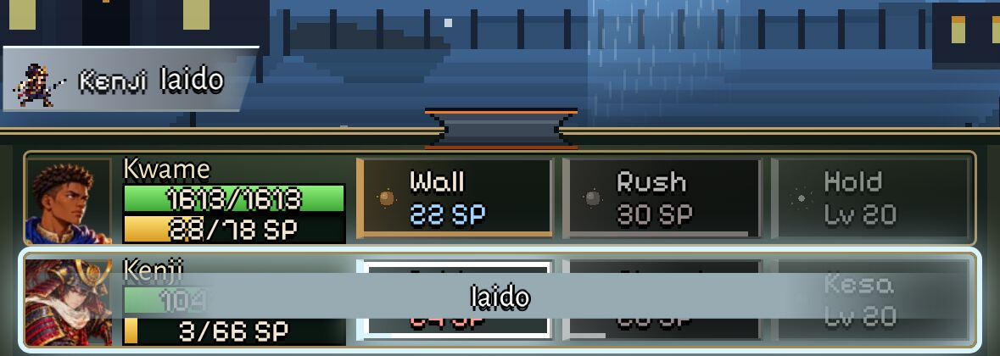 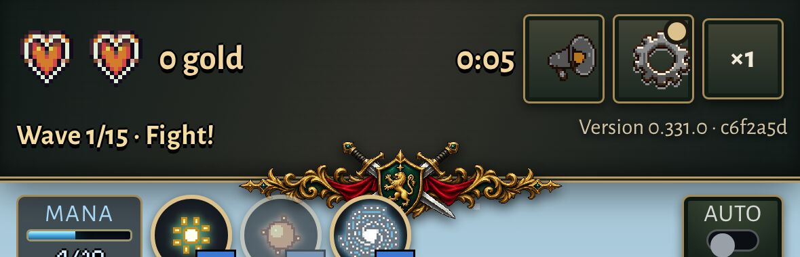

**What is wrong.** When a skill fires, its name banner ("Iaido") is drawn across that hero's own HUD row, hiding the HP bar and the skill chips at the moment you would look at them. The HP and SP numbers are about 8 to 9 px on the phone, skill chips are 32 px tall, spell buttons 40 px, the AUTO switch label "ULT+SPELL" is 7 px, and the crest ornament overlaps the middle spell button.

**Recommendation.** Show the skill banner above the HUD (over the board, as the "Kenji Iaido" tag already does) and only flash the row's border. Make skill chips and spell buttons at least 44 px tall, set HP/SP numbers to 11 px or more, and move the crest up or shrink it so it clears the spell row.

### 4. Red badges everywhere, so none of them mean anything

*Home · impact high · effort medium*

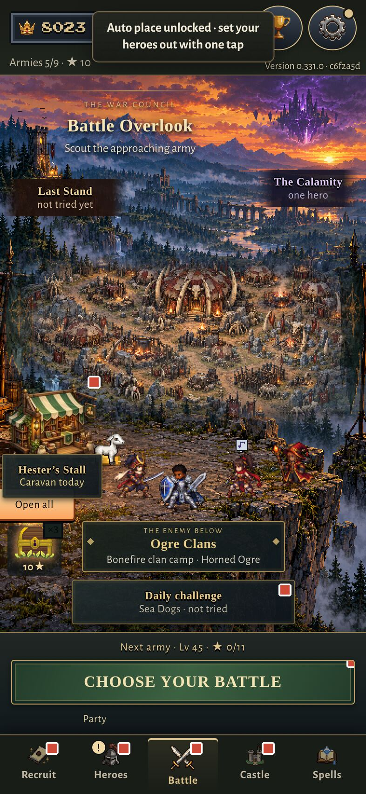 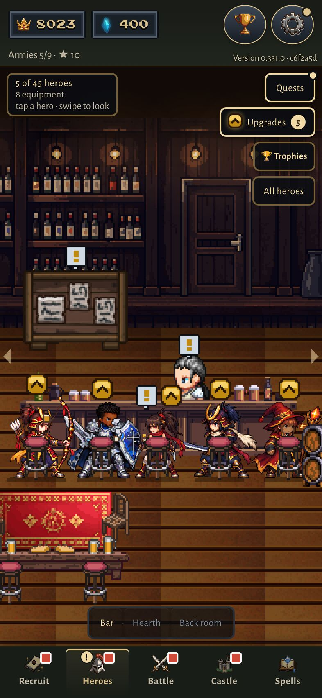

**What is wrong.** On the mid-game save every bottom tab carries a red square, as do Daily challenge, Choose your battle and the settings gear; the tavern adds a yellow arrow over every hero and "!" marks. When everything is flagged the player stops reading the flags.

**Recommendation.** Badge only something the player can act on right now, clear it when the page is opened, and prefer a number ("Upgrades 22") to a bare dot. One badge per tab at most; none on the main Battle button.

### 5. Toasts, quips and cards land on top of each other and the top bar

*Toasts and cards · impact high · effort medium*

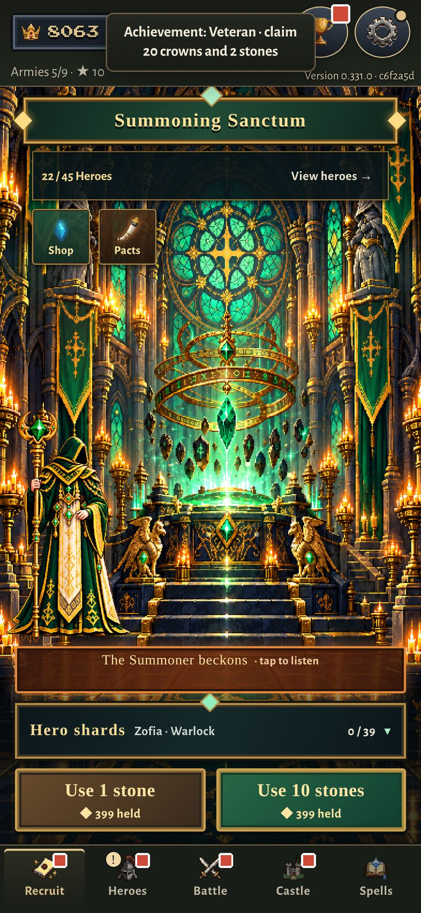 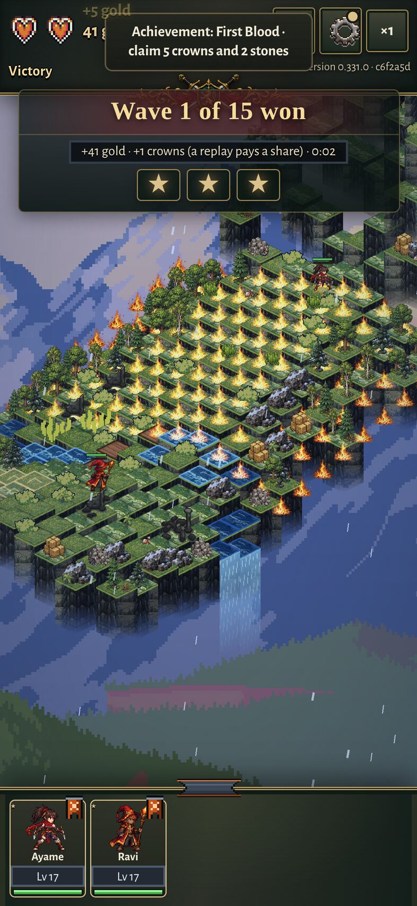 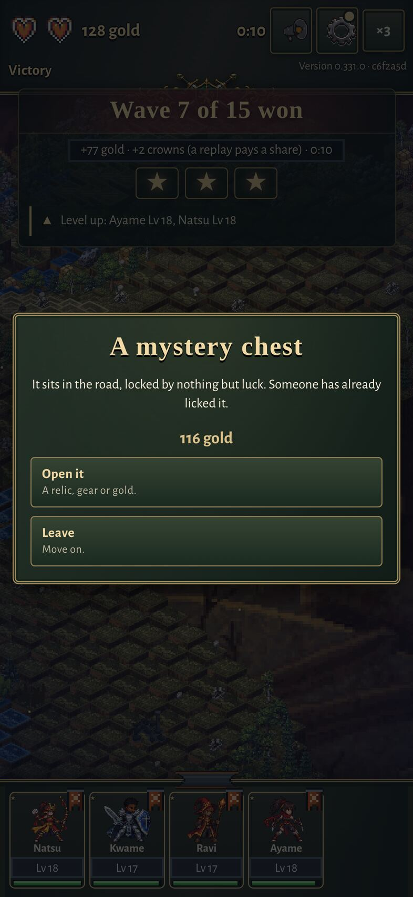 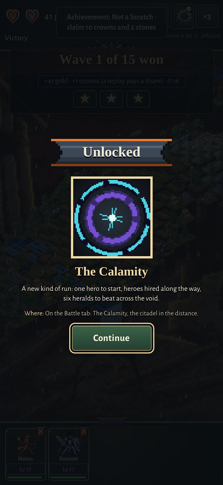

**What is wrong.** Achievement toasts cover the crowns counter and the settings gear, and in a fight the gold and version line. Hero quip bubbles sit over the HUD and over the starter pick's heading. A road event card ("A mystery chest") opens while the "Wave 7 of 15 won" card is still showing, so two cards fight for focus. An unlock card (the Calamity) pops over a wave result in the middle of an army run.

**Recommendation.** Give toasts one lane under the top bar and queue them. Keep quips off the HUD and off headings. Show cards one at a time: wave result, then event, then unlocks; hold unlock cards and films until the run is back at the home screen.

### 6. Many tap targets are under 44 px

*Everywhere · impact high · effort small*

 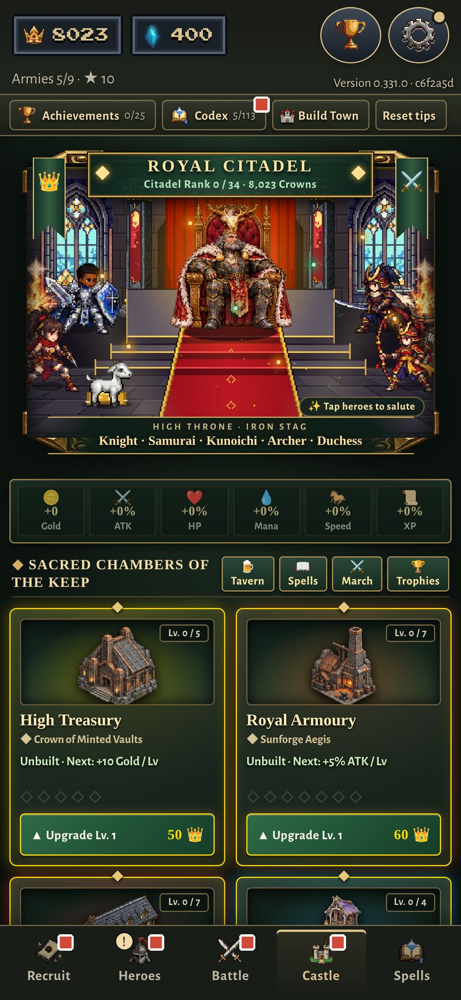 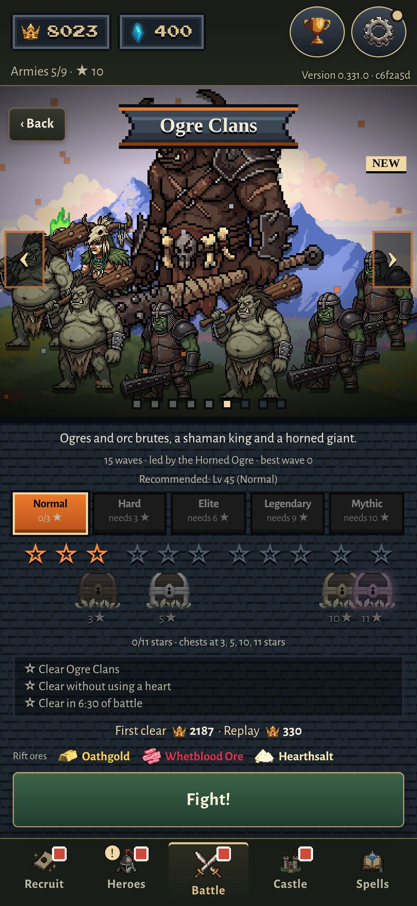

**What is wrong.** Measured at 393x852: the Party link under Choose your battle is 180x24; the army picker's dots are 10x10 and its Back is 54x32; the Castle chips (Achievements, Codex, Build Town, Reset tips) are 26 px tall and the chamber shortcuts 42x30; the tavern buttons are 36 px; fight skill chips 32 px.

**Recommendation.** Give every control at least a 44x44 hit area (padding or a ::before), even where the drawn button stays small. Turn the Party link into a real secondary button beside Choose your battle.

### 7. Films use under half the screen and their words are small

*Cinematics · impact medium · effort medium*

 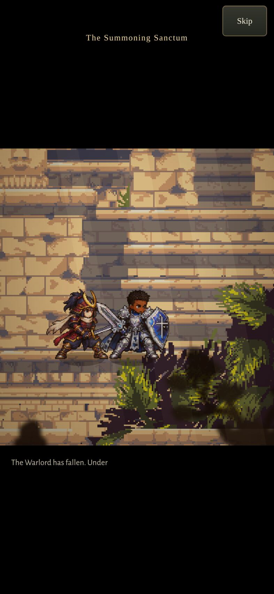

**What is wrong.** The film picture sits in a band in the middle of the phone with a large black area above it and a larger one below, where the 12 px caption sits alone. The "Legends of" line of the title straddles the top edge of the picture.

**Recommendation.** Scale the stage to fill the width and more of the height (crop the sides of the art rather than letterbox top and bottom), and raise the caption to 15 to 16 px in a box tied to the bottom of the picture. Put the title inside the picture.

### 8. Five heroes picked, then an empty board that says "hire two"

*Battle prep · impact medium · effort small*

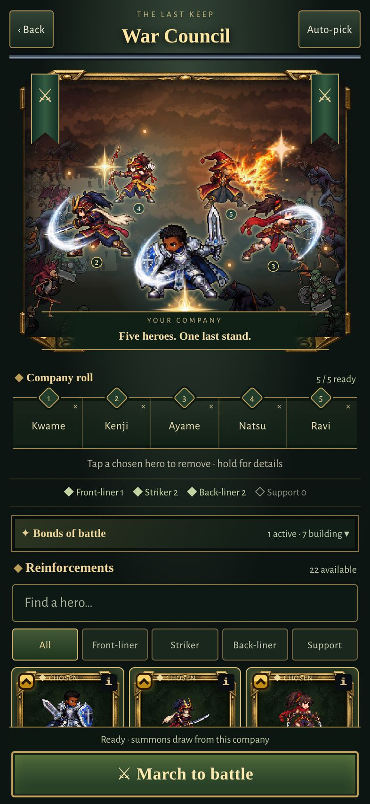 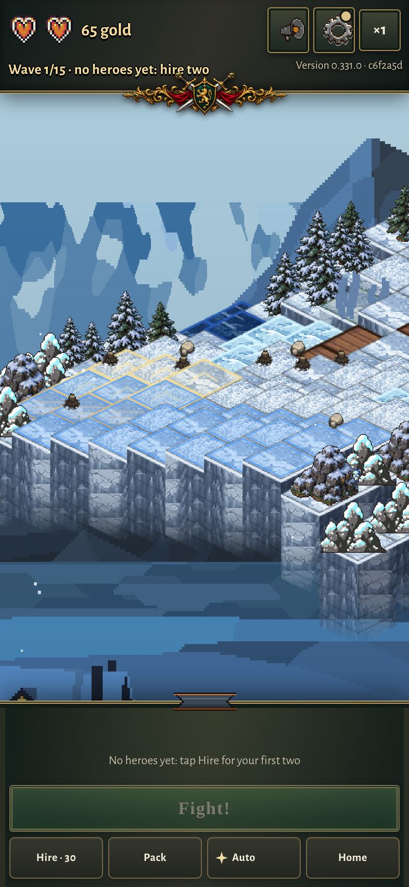

**What is wrong.** The War Council has the player choose five heroes and "March to battle", then the deploy screen opens with none of them on it: "no heroes yet: hire two", 65 gold, Hire · 30, and a large greyed-out Fight! button. The step between choosing a company and hiring from it is not explained.

**Recommendation.** On the first deploy of a run, say what the company is for ("Your five are the pool you hire from, 30 gold each"), make Hire the lit primary button until two are hired, and only then light Fight!. Consider placing the first two free.

### 9. Losing a wave is barely shown

*Fight · impact medium · effort small*

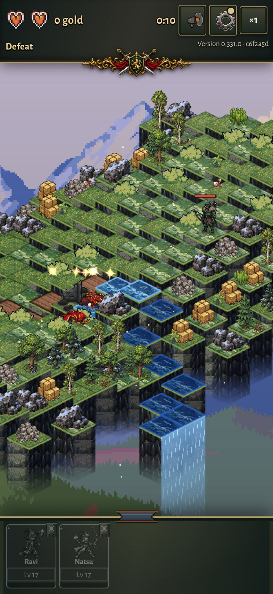 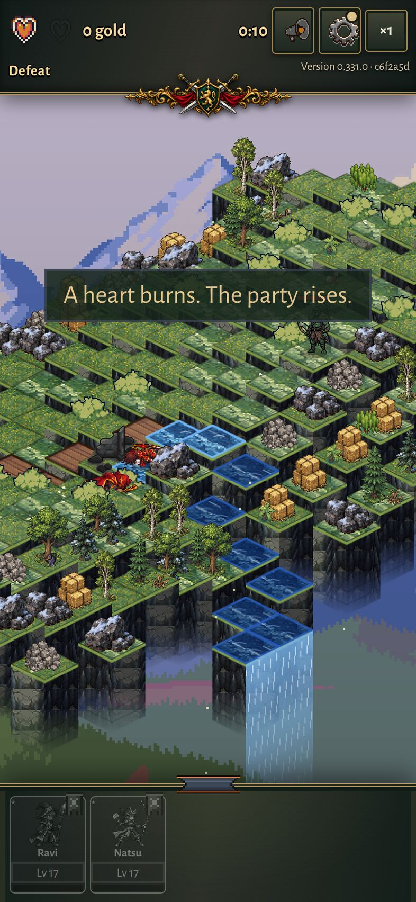

**What is wrong.** A lost wave shows the word "Defeat" in small type at the top left, a heart greys out, a one-line banner says "A heart burns. The party rises.", and the wave restarts. Nothing says how many hearts are left or what went wrong.

**Recommendation.** Show a short defeat card like the victory one: "Wave 1 lost · 1 heart left", the hero who fell first, and Retry / Change party. Label the hearts as lives the first time one is spent.

### 10. Too much 8 to 10 px text

*Everywhere · impact medium · effort medium*

 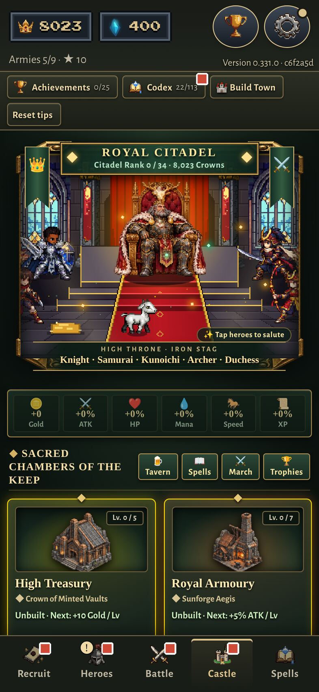 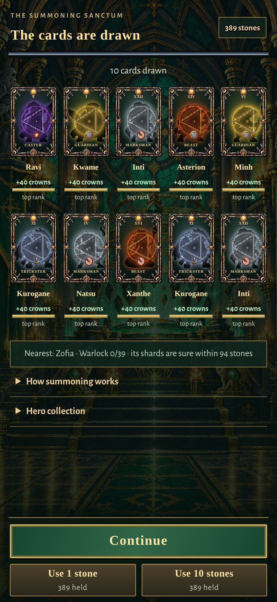

**What is wrong.** Measured font sizes: 8 px "The enemy below" and "High throne · Iron Stag", 9 px "The war council", the Castle's stat labels (Gold, ATK, HP, Mana, Speed, XP) and "Lv. 0 / 5", 10 px tier labels on the army picker, the hero sheet's ability labels, and the ten-card summon text. On a phone held at arm's length these do not read.

**Recommendation.** Set a floor of 11 px for any label and 13 px for anything a player must read to decide. Where a label will not fit at that size, drop it rather than shrink it.

### 11. The same places are reachable from many doors

*Navigation · impact medium · effort small*

 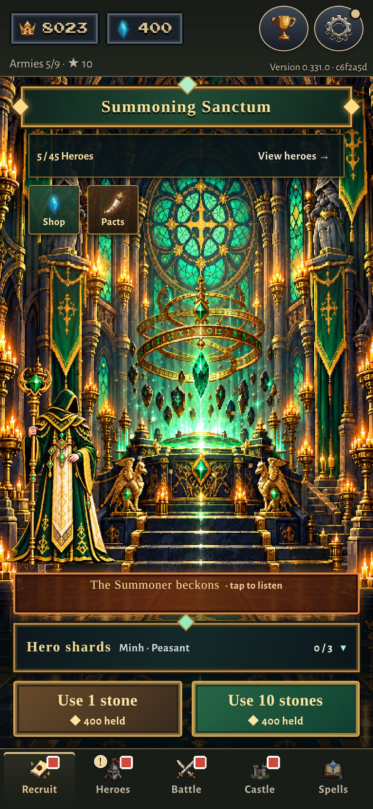 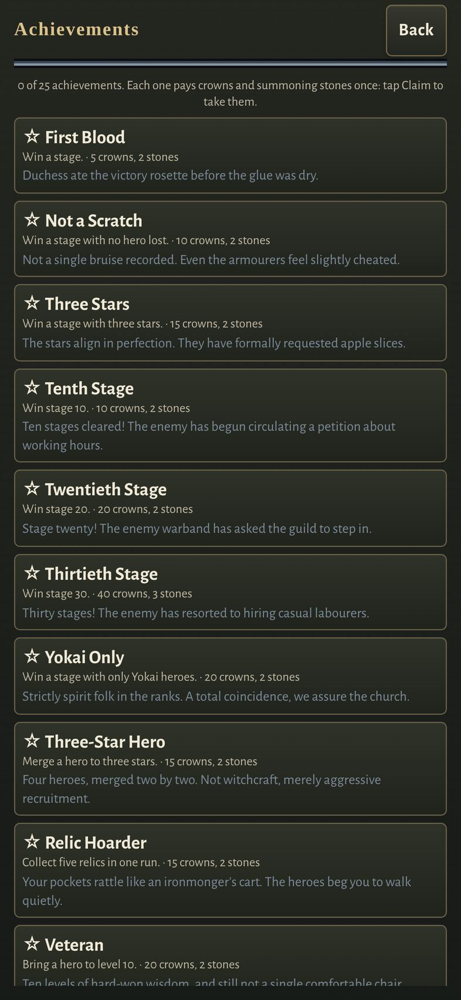

**What is wrong.** Achievements open from the trophy in the top bar, the Castle chip, the tavern's Trophies button and the Castle's "Trophies" shortcut. The Castle's "Sacred chambers" row repeats the bottom tabs (Tavern, Spells, March). The summoning hall's Shop opens Hester's Stall on its Chests tab. Reset tips sits on the Castle page and in Settings.

**Recommendation.** Keep one door per place: the trophy in the top bar for achievements, the bottom tabs for the main pages, Settings for Reset tips. Remove the Castle's shortcut row and chip bar, which frees the Castle's top for its own content.

### 12. Five different ways to close a page

*Everywhere · impact medium · effort small*

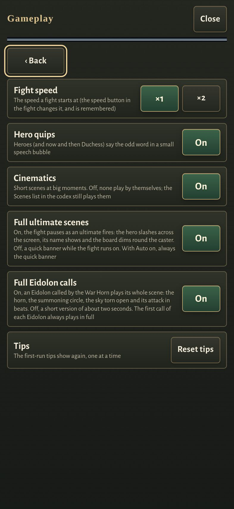 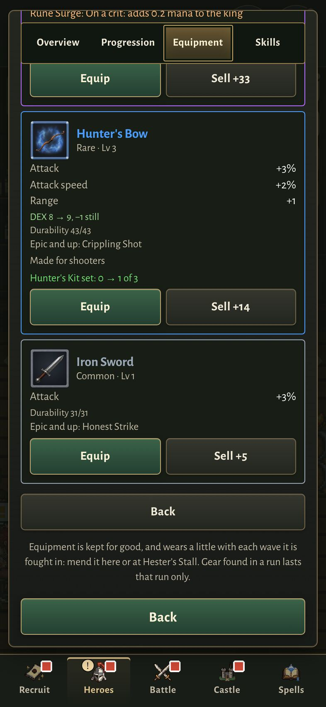 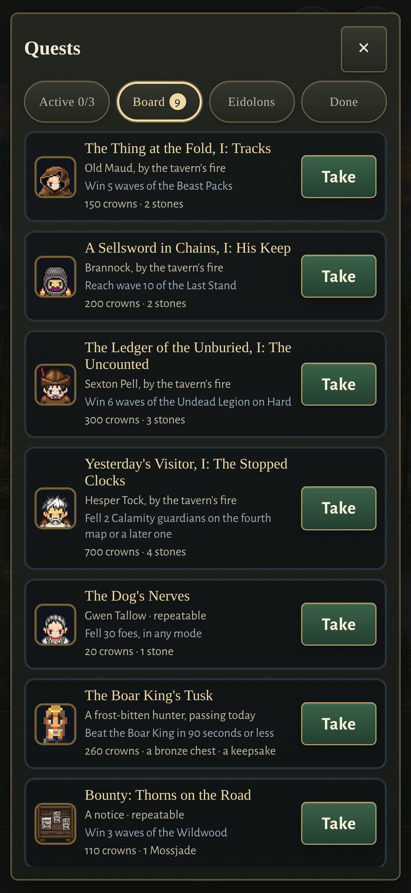 

**What is wrong.** Pages close with "×" (Quests, Pact Gallery, Upgrades), "Close" (Settings, Pack), "Back" (Achievements, hero sheet), "‹ Back" (army picker, War Council) or "‹" (Hester's Stall). Settings sub-pages have both a framed "‹ Back" and "Close". The equipment picker shows two Back buttons, one under the other.

**Recommendation.** Pick one rule: full pages get "‹ Back" top left; sheets and pop-ups get "×" top right. Drop the second Back in the equipment picker and the extra Close on Settings sub-pages.

### 13. Sell sits beside Equip at the same size

*Equipment · impact medium · effort small*

**What is wrong.** In the equipment picker each piece has "Equip" and "Sell +33" side by side, equal width. A slip sells the piece, and the page shows no undo.

**Recommendation.** Make Sell a small text button under the piece (or behind a long press), and give a short undo toast after a sale.

### 14. The Upgrades list: a stale count and no result after an awakening

*Rank-up · impact medium · effort small*

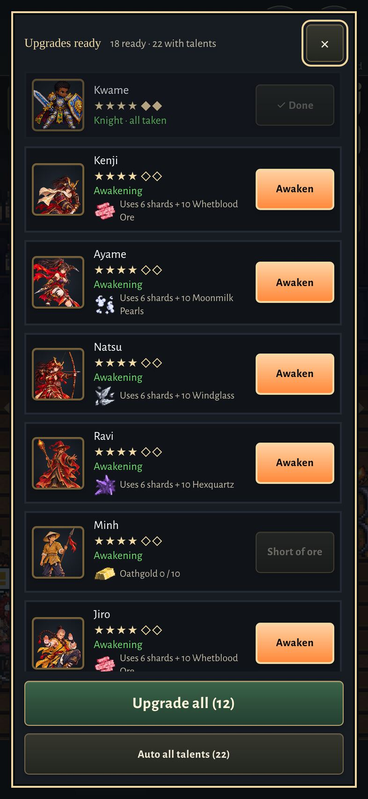

**What is wrong.** After awakening two heroes from the tavern's Upgrades list, the header still reads "22 ready" while the button reads "Upgrade all (12)" (it became "18 ready" only later). Tapping Awaken applies at once: no card shows what changed (the rank-up card added in 0.330.0 shows from the hero sheet only). The bright orange Awaken buttons are the only orange buttons in the game.

**Recommendation.** Recount the header with the button. Show the rank-up card (or a compact version) after each Awaken from the list. Use the game's green primary style for Awaken.

### 15. The deploy tip shows on the War Council

*Tips · impact medium · effort small*

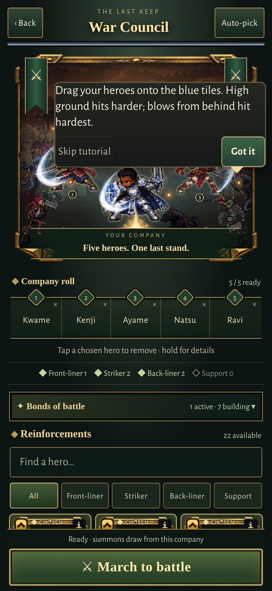

**What is wrong.** With tips on, "Drag your heroes onto the blue tiles. High ground hits harder…" appears over the War Council party picker, where there are no tiles; the deploy board is behind the picker.

**Recommendation.** Offer the deploy tip only when the deploy screen is the visible page (no party sheet, card or film over it).

### 16. Earned chests are easy to miss, and "Open all" is cut off

*Home · impact medium · effort small*

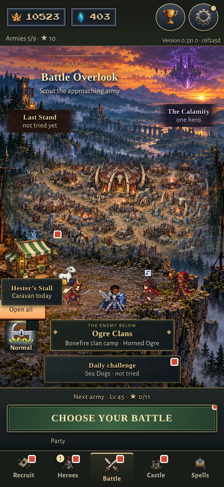 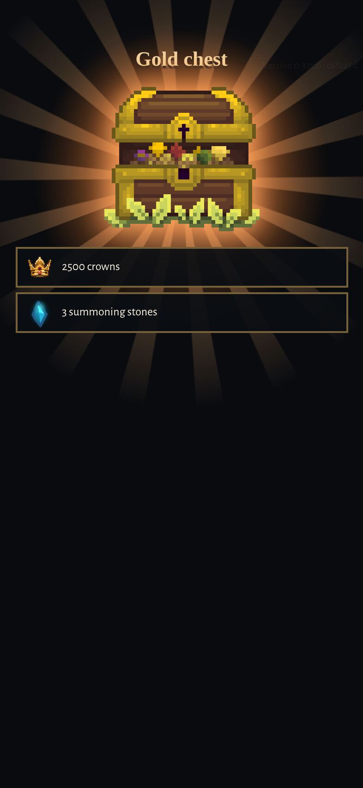

**What is wrong.** Chests rest as a small icon over the art at the lower left of the Battle Overlook; the "Open all" pill starts 7 px off the left edge of the screen at all three phone sizes.

**Recommendation.** Pull the stash into the safe area and give it a labelled button ("3 chests") near Choose your battle. The chest opening itself reads well.

### 17. The hero sheet's Overview is a wall of numbers

*Hero sheet · impact medium · effort medium*

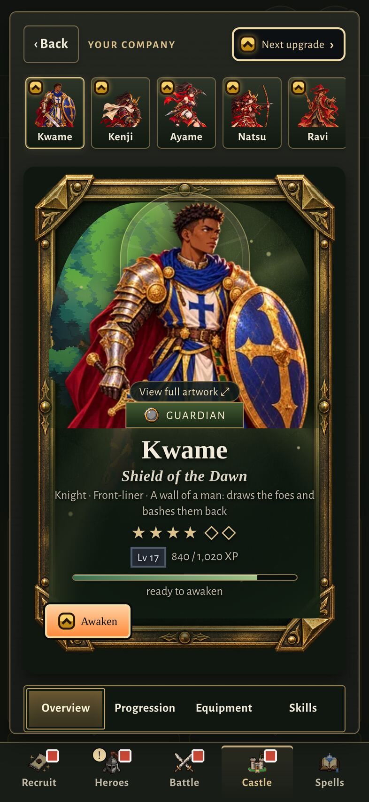 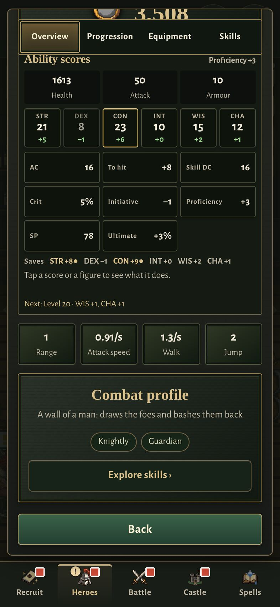 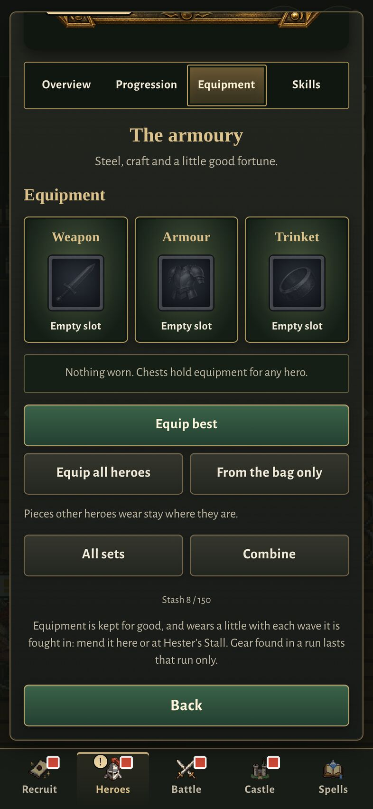

**What is wrong.** Overview shows Health/Attack/Armour, six ability scores, eight figures (AC, To hit, Skill DC, Crit, Initiative, Proficiency, SP, Ultimate), saving throws, then Range, Attack speed, Walk and Jump. Equipment adds six buttons (Equip best, Equip all heroes, From the bag only, All sets, Combine, Back). Every tab ends in a full-width Back as well as the bottom tabs.

**Recommendation.** Lead Overview with the hero's role line, power, HP and attack and one "Details" fold for the scores and figures. On Equipment keep "Equip best" and move the rest into a "More" menu.

### 18. A whole tab that only says "locked"

*Home · impact low · effort small*

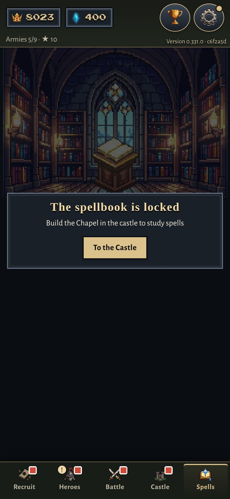

**What is wrong.** Until the Chapel is built, the Spells tab is a picture and "The spellbook is locked" with a button to the Castle. It is one of five tabs from the first minute.

**Recommendation.** Hide the tab (or show it dimmed with a lock and the reason on tap) until the Chapel exists, as Last Stand and the Calamity already do on the Overlook.

### 19. The ten-card summon is small and samey

*Summoning · impact low · effort medium*

 

**What is wrong.** Ten cards share the top half of the screen with names and "+40 crowns · top rank" in tiny type; when every card is a duplicate turned into crowns, the screen reads as one repeated line.

**Recommendation.** Group repeats ("7 × top rank → 280 crowns") and give the new heroes or new shards the large cards.

### 20. Seven small tabs in the stall

*Hester's Stall · impact low · effort small*

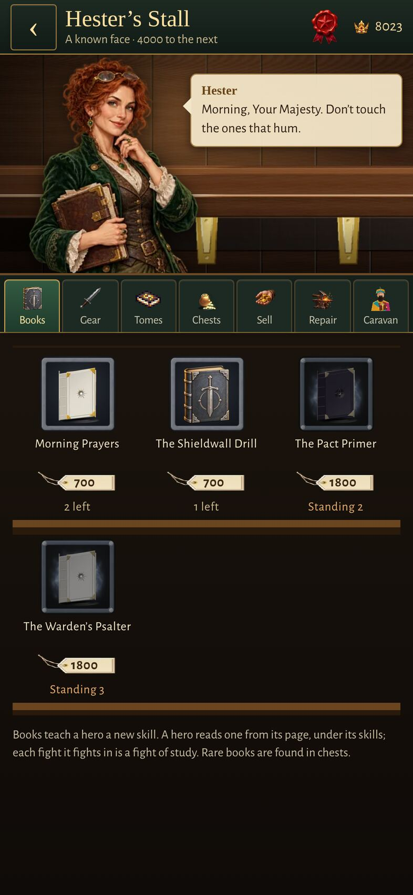

**What is wrong.** Books, Gear, Tomes, Chests, Sell, Repair and Caravan share one row of small icon tabs with 9 px labels.

**Recommendation.** Two rows or a scrolling tab strip with 13 px labels; fold Sell and Repair into one "Mend and sell" tab.

### 21. The Last Stand picker is a dense grid with the actions below the fold

*Last Stand · impact low · effort small*

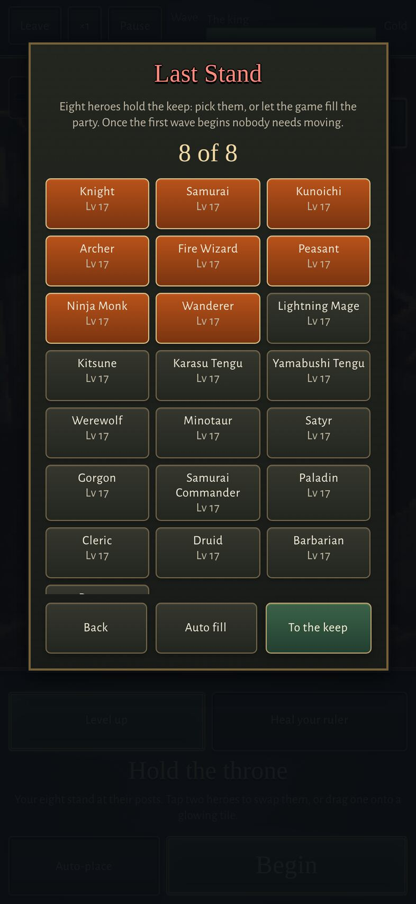

**What is wrong.** Twenty-odd heroes as name buttons in three columns, with the eight picked shown only by colour; the grid scrolls inside the panel and its last row is cut.

**Recommendation.** Show the eight picked as portraits in a strip at the top, and the pool below with portraits, like the War Council.

### 22. Unlock cards say where to go while the player is already there

*Unlocks · impact low · effort small*

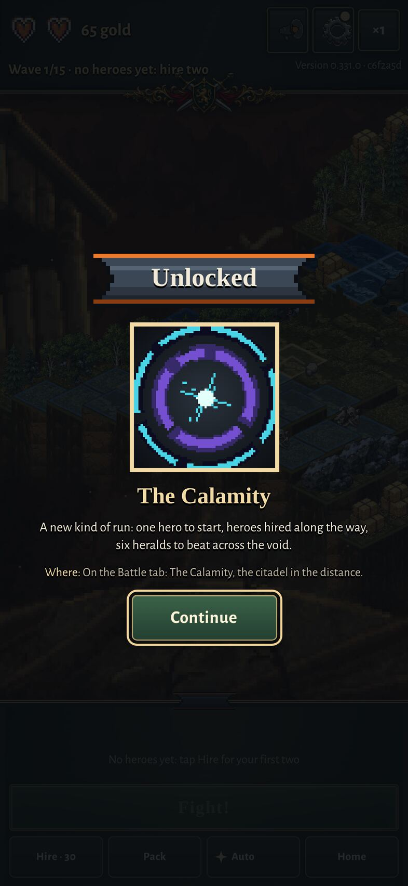 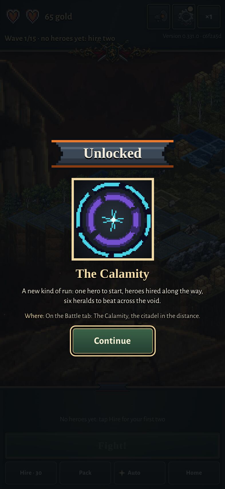

**What is wrong.** Tapping The Calamity on the Overlook first shows an "Unlocked" card that says "Where: On the Battle tab: The Calamity, the citadel in the distance" — the place just tapped.

**Recommendation.** When the unlock is told on arrival, drop the "Where" line and lead straight into the screen.

### 23. Old words remain: "stage", "New run"

*Words · impact low · effort small*

 

**What is wrong.** Achievements still talk of "Win a stage", "Tenth Stage", "Thirtieth Stage" while the game now counts armies and waves; the first tip says "New run".

**Recommendation.** Rename to waves and armies ("Win a wave", "Clear ten waves") and update the tip.

## What works

- The art is strong and consistent: the Overlook, the Sanctum, the tavern and the Eidolon call are the best screens in the game.
- Layouts hold at all three phone sizes: no page scrolls sideways, and only one control (Open all) leaves the screen.
- The War Horn asks before it fires (Not now / Blow the horn) and the Eidolon call that follows is a clear high point.
- Chest openings, the daily challenge card and the road event cards are clear: one title, one line, two or three big choices.
- Settings are well grouped, each with a one-line description, and Skip is on every film.

## Screens covered

- Opening film: `docs/samples/ux-audit/opening-cine.jpg`
- Starter pick: `docs/samples/ux-audit/starter-picked.jpg`
- Film after the pick: `docs/samples/ux-audit/second-film.jpg`
- First home screen: `docs/samples/ux-audit/first-tip.jpg`
- Battle Overlook (home): `docs/samples/ux-audit/home-badges.jpg`
- Summoning Sanctum: `docs/samples/ux-audit/sanctum.jpg`
- Sanctum at 412x915: `docs/samples/ux-audit/sanctum-412.jpg`
- Tavern: `docs/samples/ux-audit/tavern.jpg`
- Castle: `docs/samples/ux-audit/castle.jpg`
- Castle at 360x780: `docs/samples/ux-audit/castle-360.jpg`
- Spells: `docs/samples/ux-audit/spells-locked.jpg`
- Army picker: `docs/samples/ux-audit/armies.jpg`
- War Council: `docs/samples/ux-audit/war-council.jpg`
- Deploy: `docs/samples/ux-audit/deploy-empty.jpg`
- Fight: `docs/samples/ux-audit/fight-hud.jpg`
- Fight with the War Horn: `docs/samples/ux-audit/horn-button.jpg`
- Eidolon call: `docs/samples/ux-audit/horn-call.jpg`
- Road event: `docs/samples/ux-audit/event-card.jpg`
- Defeat: `docs/samples/ux-audit/defeat.jpg`
- Unlock card: `docs/samples/ux-audit/unlock-mid-run.jpg`
- Chest: `docs/samples/ux-audit/chest.jpg`
- Chest stash: `docs/samples/ux-audit/chest-stash.jpg`
- Hero roster: `docs/samples/ux-audit/roster.jpg`
- Hero sheet: `docs/samples/ux-audit/hero-sheet.jpg`
- Hero overview: `docs/samples/ux-audit/hero-overview.jpg`
- Hero equipment: `docs/samples/ux-audit/hero-equipment.jpg`
- Equipment picker: `docs/samples/ux-audit/equip-picker.jpg`
- Talents: `docs/samples/ux-audit/talents.jpg`
- Upgrades (rank-up): `docs/samples/ux-audit/upgrades-list.jpg`
- Ten-card summon: `docs/samples/ux-audit/pull10.jpg`
- Hester's Stall: `docs/samples/ux-audit/stall.jpg`
- Quests: `docs/samples/ux-audit/quests.jpg`
- Codex: `docs/samples/ux-audit/codex.jpg`
- Achievements: `docs/samples/ux-audit/achievements.jpg`
- Daily challenge: `docs/samples/ux-audit/daily.jpg`
- Last Stand: `docs/samples/ux-audit/last-stand.jpg`
- The Calamity: `docs/samples/ux-audit/calamity.jpg`
- Eidolon chain film: `docs/samples/ux-audit/chain-film.jpg`
- Settings: `docs/samples/ux-audit/settings.jpg`
- Settings · Gameplay: `docs/samples/ux-audit/settings-gameplay.jpg`
- Settings · Developer: `docs/samples/ux-audit/settings-developer.jpg`

## Method notes

- Built with `npm run web`, served from `out/web`, driven by Playwright (Chromium with SwiftShader). The film shots were flattened onto black: headless WebGL leaves the band outside the film picture transparent, which a phone shows as the cutscene's black.
- Control sizes and font sizes were read from the page (`getBoundingClientRect`, computed `font-size`) on the visible, top-most element.
- The save builder and walk scripts were throwaway (kept out of the repo); the saves used only the sim's own functions (`startedMeta`, `settleWave`, `grantSampleEquipment`).
